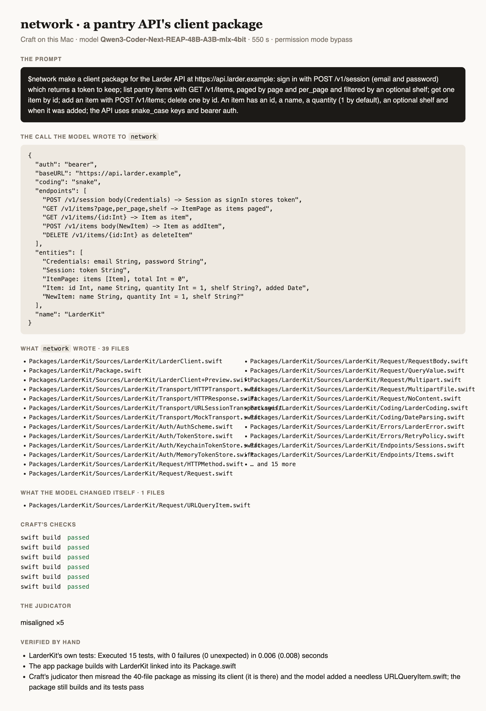
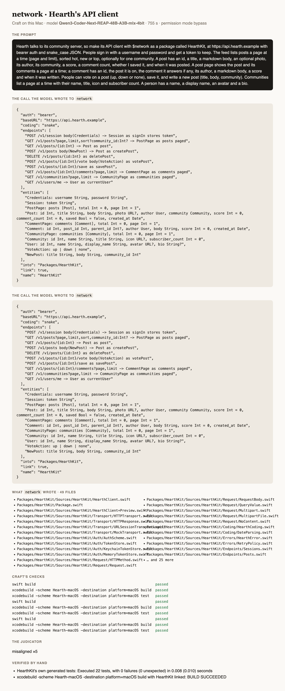

# Testing NetworkAgent

How `network` is tested: its own suite, its gated build of real output, and prompts run through
[Craft](https://github.com/riteshpakala/Craft) on a Mac with Craft's own local model, each logged below verbatim with
what came out. A prompt is run as a person would type it, in a project folder, with `$` naming the agent; nothing is
edited between the prompt and the screenshots. A test that needs a server uses mock backend responses, never a live
service.

## The suite

```
swift test                                  # the record, the schema, the lines, the files, a call through the roster
NETWORK_BUILD=1 swift test --filter NetworkBuildTests   # the output built for real (gated, minutes)
```

## Prompts run on this Mac

Setup: MacBook Pro M4 Max (128 GB), macOS 27, Xcode 27.1, Craft built from `main`, the model Craft loads
(`rao-studios/Qwen3-Coder-Next-REAP-48B-A3B-mlx-4bit`), permission mode bypass, the agent installed from this repository
with `craft agents add`.

### 1. A pantry API's client package, linked into the app

*2026-11-01 · Qwen3-Coder-Next-REAP-48B-A3B-mlx-4bit · 550 s*

**The prompt**, verbatim:

```text
$network make a client package for the Larder API at https://api.larder.example: sign in with POST /v1/session (email and password) which returns a token to keep; list pantry items with GET /v1/items, paged by page and per_page and filtered by an optional shelf; get one item by id; add an item with POST /v1/items; delete one by id. An item has an id, a name, a quantity (1 by default), an optional shelf and when it was added; the API uses snake_case keys and bearer auth.
```

**The call the model wrote** to `network`:

```json
{
  "auth": "bearer",
  "baseURL": "https://api.larder.example",
  "coding": "snake",
  "endpoints": [
    "POST /v1/session body(Credentials) -> Session as signIn stores token",
    "GET /v1/items?page,per_page,shelf -> ItemPage as items paged",
    "GET /v1/items/{id:Int} -> Item as item",
    "POST /v1/items body(NewItem) -> Item as addItem",
    "DELETE /v1/items/{id:Int} as deleteItem"
  ],
  "entities": [
    "Credentials: email String, password String",
    "Session: token String",
    "ItemPage: items [Item], total Int = 0",
    "Item: id Int, name String, quantity Int = 1, shelf String?, added Date",
    "NewItem: name String, quantity Int = 1, shelf String?"
  ],
  "name": "LarderKit"
}
```

**What `network` wrote** (39 files): `Packages/LarderKit/Sources/LarderKit/LarderClient.swift`, `Packages/LarderKit/Package.swift`, `Packages/LarderKit/Sources/LarderKit/LarderClient+Preview.swift`, `Packages/LarderKit/Sources/LarderKit/Transport/HTTPTransport.swift`, `Packages/LarderKit/Sources/LarderKit/Transport/HTTPResponse.swift`, `Packages/LarderKit/Sources/LarderKit/Transport/URLSessionTransport.swift`, `Packages/LarderKit/Sources/LarderKit/Transport/MockTransport.swift`, `Packages/LarderKit/Sources/LarderKit/Auth/AuthScheme.swift`, `Packages/LarderKit/Sources/LarderKit/Auth/TokenStore.swift`, `Packages/LarderKit/Sources/LarderKit/Auth/KeychainTokenStore.swift`, `Packages/LarderKit/Sources/LarderKit/Auth/MemoryTokenStore.swift`, `Packages/LarderKit/Sources/LarderKit/Request/HTTPMethod.swift`, `Packages/LarderKit/Sources/LarderKit/Request/Request.swift`, `Packages/LarderKit/Sources/LarderKit/Request/RequestBody.swift`, `Packages/LarderKit/Sources/LarderKit/Request/QueryValue.swift`, `Packages/LarderKit/Sources/LarderKit/Request/Multipart.swift`, `Packages/LarderKit/Sources/LarderKit/Request/MultipartFile.swift`, `Packages/LarderKit/Sources/LarderKit/Request/NoContent.swift`, `Packages/LarderKit/Sources/LarderKit/Coding/LarderCoding.swift`, `Packages/LarderKit/Sources/LarderKit/Coding/DateParsing.swift`, `Packages/LarderKit/Sources/LarderKit/Errors/LarderError.swift`, `Packages/LarderKit/Sources/LarderKit/Errors/RetryPolicy.swift`, `Packages/LarderKit/Sources/LarderKit/Endpoints/Sessions.swift`, `Packages/LarderKit/Sources/LarderKit/Endpoints/Items.swift`, `Packages/LarderKit/Sources/LarderKit/Models/Credentials.swift`, `Packages/LarderKit/Sources/LarderKit/Models/Session.swift`, `Packages/LarderKit/Sources/LarderKit/Models/ItemPage.swift`, `Packages/LarderKit/Sources/LarderKit/Models/Item.swift`, `Packages/LarderKit/Sources/LarderKit/Models/NewItem.swift`, `Packages/LarderKit/Sources/LarderKit/Paging/Page.swift` …

**What the model changed itself**: `Packages/LarderKit/Sources/LarderKit/Request/URLQueryItem.swift`

**Craft's checks**: `swift build` passed; `swift build` passed; `swift build` passed; `swift build` passed; `swift build` passed; `swift build` passed

**The judicator**: misaligned ×5

**Verified by hand**:
- LarderKit's own generated tests: Executed 15 tests, with 0 failures (0 unexpected) in 0.006 (0.008) seconds
- The app package builds with LarderKit linked into its Package.swift


*The outcome card: the prompt, the call, the 40 files and the checks*

**Notes**:
- The model wrote the endpoint and entity lines correctly on its first try.
- Craft's judicator then read only part of the 40-file package, judged it to have no client (LarderClient, Request and send are all there) four times, and the model added a needless Request/URLQueryItem.swift; the package still builds and its tests pass. A judicator finding, not the agent's.

### 2. Hearth's API client from a plain description of the server (the journey's fourth prompt)

*2026-11-01 · Qwen3-Coder-Next-REAP-48B-A3B-mlx-4bit · 755 s*

**The prompt**, verbatim:

```text
Hearth talks to its community server, so make its API client with $network as a package called HearthKit, at https://api.hearth.example with bearer auth and snake_case JSON. People sign in with a username and password and get a token to keep. The feed lists posts a page at a time (page and limit), sorted hot, new or top, optionally for one community. A post has an id, a title, a markdown body, an optional photo, its author, its community, a score, a comment count, whether I saved it, and when it was posted. A post page shows the post and its comments a page at a time; a comment has an id, the post it is on, the comment it answers if any, its author, a markdown body, a score and when it was written. People can vote on a post (up, down or none), save it, and write a new post (title, body, community). Communities list a page at a time with their name, title, icon and subscriber count. A person has a name, a display name, an avatar and a bio.
```

**The call the model wrote** to `network`:

```json
{
  "auth": "bearer",
  "baseURL": "https://api.hearth.example",
  "coding": "snake",
  "endpoints": [
    "POST /v1/session body(Credentials) -> Session as signIn stores token",
    "GET /v1/posts?page,limit,sort?community_id:Int? -> PostPage as posts paged",
    "GET /v1/posts/{id:Int} -> Post as post",
    "POST /v1/posts body(NewPost) -> Post as createPost",
    "DELETE /v1/posts/{id:Int} as deletePost",
    "POST /v1/posts/{id:Int}/vote body(VoteAction) as votePost",
    "POST /v1/posts/{id:Int}/save as savePost",
    "GET /v1/posts/{id:Int}/comments?page,limit -> CommentPage as comments paged",
    "GET /v1/communities?page,limit -> CommunityPage as communities paged",
    "GET /v1/users/me -> User as currentUser"
  ],
  "entities": [
    "Credentials: username String, password String",
    "Session: token String",
    "PostPage: posts [Post], total Int = 0, page Int = 1",
    "Post: id Int, title String, body String, photo URL?, author User, community Community, score Int = 0, comment_count Int = 0, saved Bool = false, created_at Date",
    "CommentPage: comments [Comment], total Int = 0, page Int = 1",
    "Comment: id Int, post_id Int, parent_id Int?, author User, body String, score Int = 0, created_at Date",
    "CommunityPage: communities [Community], total Int = 0, page Int = 1",
    "Community: id Int, name String, title String, icon URL?, subscriber_count Int = 0",
    "User: id Int, name String, display_name String, avatar URL?, bio String?",
    "VoteAction: up | down | none",
    "NewPost: title String, body String, community_id Int"
  ],
  "into": "Packages/HearthKit",
  "link": true,
  "name": "HearthKit"
}
```

**The call the model wrote** to `network`:

```json
{
  "auth": "bearer",
  "baseURL": "https://api.hearth.example",
  "coding": "snake",
  "endpoints": [
    "POST /v1/session body(Credentials) -> Session as signIn stores token",
    "GET /v1/posts?page,limit,sort,community_id:Int? -> PostPage as posts paged",
    "GET /v1/posts/{id:Int} -> Post as post",
    "POST /v1/posts body(NewPost) -> Post as createPost",
    "DELETE /v1/posts/{id:Int} as deletePost",
    "POST /v1/posts/{id:Int}/vote body(VoteAction) as votePost",
    "POST /v1/posts/{id:Int}/save as savePost",
    "GET /v1/posts/{id:Int}/comments?page,limit -> CommentPage as comments paged",
    "GET /v1/communities?page,limit -> CommunityPage as communities paged",
    "GET /v1/users/me -> User as currentUser"
  ],
  "entities": [
    "Credentials: username String, password String",
    "Session: token String",
    "PostPage: posts [Post], total Int = 0, page Int = 1",
    "Post: id Int, title String, body String, photo URL?, author User, community Community, score Int = 0, comment_count Int = 0, saved Bool = false, created_at Date",
    "CommentPage: comments [Comment], total Int = 0, page Int = 1",
    "Comment: id Int, post_id Int, parent_id Int?, author User, body String, score Int = 0, created_at Date",
    "CommunityPage: communities [Community], total Int = 0, page Int = 1",
    "Community: id Int, name String, title String, icon URL?, subscriber_count Int = 0",
    "User: id Int, name String, display_name String, avatar URL?, bio String?",
    "VoteAction: up | down | none",
    "NewPost: title String, body String, community_id Int"
  ],
  "into": "Packages/HearthKit",
  "link": true,
  "name": "HearthKit"
}
```

**What `network` wrote** (49 files): `Packages/HearthKit/Sources/HearthKit/HearthClient.swift`, `Packages/HearthKit/Package.swift`, `Packages/HearthKit/Sources/HearthKit/HearthClient+Preview.swift`, `Packages/HearthKit/Sources/HearthKit/Transport/HTTPTransport.swift`, `Packages/HearthKit/Sources/HearthKit/Transport/HTTPResponse.swift`, `Packages/HearthKit/Sources/HearthKit/Transport/URLSessionTransport.swift`, `Packages/HearthKit/Sources/HearthKit/Transport/MockTransport.swift`, `Packages/HearthKit/Sources/HearthKit/Auth/AuthScheme.swift`, `Packages/HearthKit/Sources/HearthKit/Auth/TokenStore.swift`, `Packages/HearthKit/Sources/HearthKit/Auth/KeychainTokenStore.swift`, `Packages/HearthKit/Sources/HearthKit/Auth/MemoryTokenStore.swift`, `Packages/HearthKit/Sources/HearthKit/Request/HTTPMethod.swift`, `Packages/HearthKit/Sources/HearthKit/Request/Request.swift`, `Packages/HearthKit/Sources/HearthKit/Request/RequestBody.swift`, `Packages/HearthKit/Sources/HearthKit/Request/QueryValue.swift`, `Packages/HearthKit/Sources/HearthKit/Request/Multipart.swift`, `Packages/HearthKit/Sources/HearthKit/Request/MultipartFile.swift`, `Packages/HearthKit/Sources/HearthKit/Request/NoContent.swift`, `Packages/HearthKit/Sources/HearthKit/Coding/HearthCoding.swift`, `Packages/HearthKit/Sources/HearthKit/Coding/DateParsing.swift`, `Packages/HearthKit/Sources/HearthKit/Errors/HearthError.swift`, `Packages/HearthKit/Sources/HearthKit/Errors/RetryPolicy.swift`, `Packages/HearthKit/Sources/HearthKit/Endpoints/Sessions.swift`, `Packages/HearthKit/Sources/HearthKit/Endpoints/Posts.swift`, `Packages/HearthKit/Sources/HearthKit/Endpoints/Communities.swift`, `Packages/HearthKit/Sources/HearthKit/Endpoints/Users.swift`, `Packages/HearthKit/Sources/HearthKit/Models/Credentials.swift`, `Packages/HearthKit/Sources/HearthKit/Models/Session.swift`, `Packages/HearthKit/Sources/HearthKit/Models/PostPage.swift`, `Packages/HearthKit/Sources/HearthKit/Models/Post.swift` …

**Craft's checks**: `swift build` passed; `xcodebuild -scheme Hearth-macOS -destination platform=macOS build` passed; `xcodebuild -scheme Hearth-macOS -destination platform=macOS test` passed; `swift build` passed; `xcodebuild -scheme Hearth-macOS -destination platform=macOS build` passed; `xcodebuild -scheme Hearth-macOS -destination platform=macOS test` passed; `swift build` passed; `xcodebuild -scheme Hearth-macOS -destination platform=macOS build` passed; `xcodebuild -scheme Hearth-macOS -destination platform=macOS test` passed

**The judicator**: misaligned ×5

**Verified by hand**:
- HearthKit's own generated tests: Executed 22 tests, with 0 failures (0 unexpected) in 0.008 (0.010) seconds
- `xcodebuild -scheme Hearth-macOS -destination platform=macOS build` with HearthKit linked into both app targets: BUILD SUCCEEDED


*The outcome card: the prompt, the two calls, the files and the checks*

**Notes**:
- The model turned a plain description into ten endpoint lines and eleven entity lines. Its first call wrote `?page,limit,sort?community_id:Int?` (a comma missing) and was refused with that line named; the second was right.
- It wrote the API's snake_case into field names (`comment_count`, `created_at`), so the Swift properties came out snake_case. The release after this run reads a snake_case field as its JSON key and names it in Swift's spelling (`commentCount`, `postID`), whatever `coding` says.
- It left `sort` a String where the prompt listed hot, new and top; an enum line would have typed it.
- Craft's judicator read the work as misaligned five times; the client, its endpoints and its tests are all there and pass. A judicator finding, reported.
